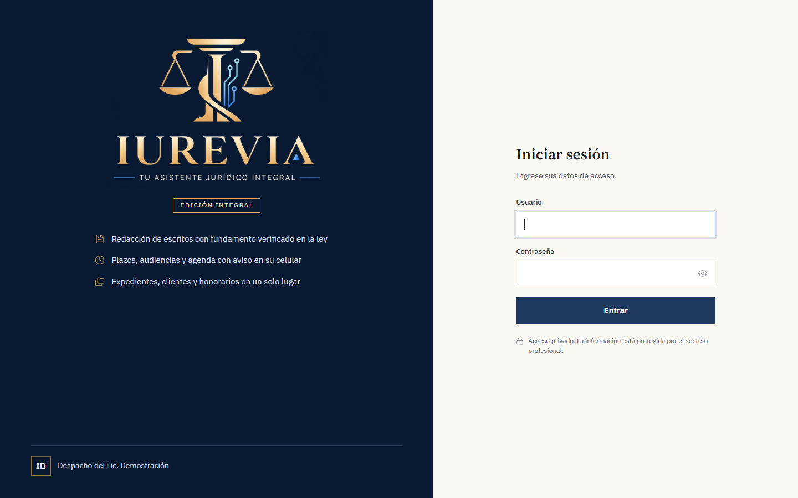
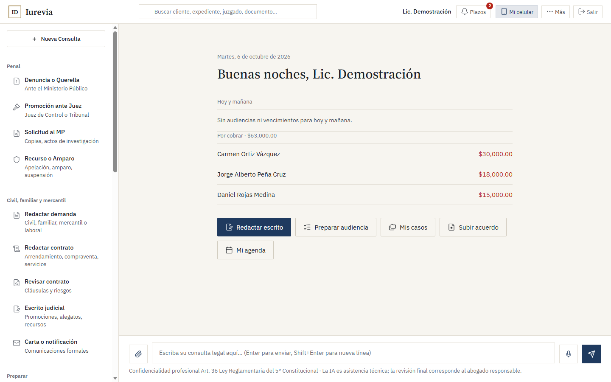
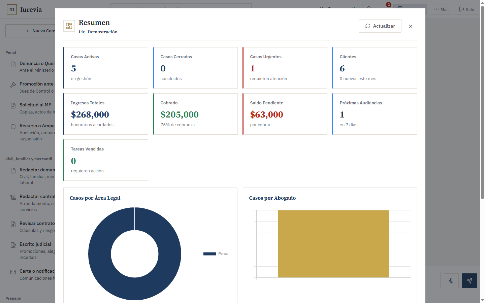
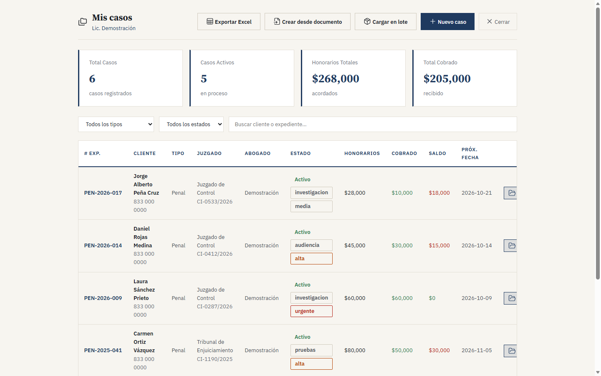
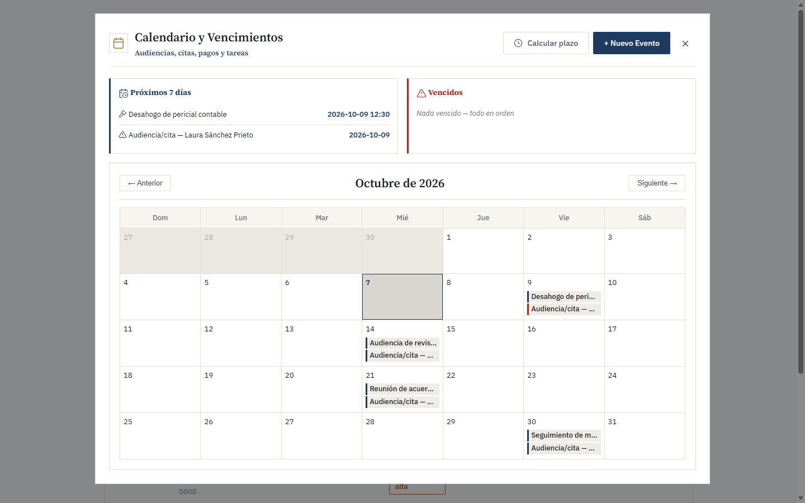

# Iurevia

Asistente jurídico con IA para despachos penalistas: expedientes, audiencias y plazos, honorarios y redacción de escritos con fundamento en la ley, todo en un solo lugar y pensado para usarse también desde el celular.

> Este repositorio es una **vitrina**: documentación y capturas con **datos completamente ficticios**. El código es privado porque el sistema se despliega para clientes.

## Estado

En producción como despliegue privado para un despacho penalista. No hay demo pública.

## Capturas (datos ficticios)

| | |
|---|---|
|  |  |
| Acceso privado con aviso de confidencialidad | Inicio: agenda del día y saldos por cobrar |
|  |  |
| Resumen: casos, honorarios y cobranza | Expedientes con etapa, prioridad y próxima fecha |

## Qué hace

- **Redacción de escritos penales:** denuncia o querella, promoción ante el Juez de Control, solicitud al Ministerio Público, recursos y amparo; además de demandas, contratos y cartas para otras materias.
- **Fundamento verificado en la ley:** las citas de artículos se contrastan contra un corpus de legislación para reducir la invención de normas.
- **Expedientes y clientes:** etapa procesal, prioridad, juzgado, partes, honorarios, cobrado y saldo.
- **Calendario y plazos:** audiencias, vencimientos y cálculo de plazos, con avisos en el celular y suscripción al calendario.
- **Preparación de audiencias:** lista de puntos a revisar por tipo de audiencia penal.
- **Documentos:** carga, extracción de texto y análisis asistido.
- **Confidencialidad:** aviso de privacidad al ingresar y revisión final siempre a cargo del abogado.

## Cómo está construido

- **Backend:** Cloudflare Workers con base de datos D1 y almacenamiento R2.
- **Búsqueda de legislación:** índice de artículos con recuperación semántica (RAG) para fundamentar los escritos.
- **IA:** API de Claude, con la llave configurada por el propio despacho.
- **Seguridad:** contraseñas con PBKDF2-SHA256, sesiones firmadas con expiración, bloqueo de intentos de acceso por IP, rutas protegidas del lado del servidor y respaldo diario.
- **Frontend:** aplicación de una sola página en HTML, CSS y JavaScript sin dependencias de compilación, usable en computadora y celular.

## Licencia

Copyright (c) 2026 Ángel Mendiola. Todos los derechos reservados. Ver [`LICENSE`](LICENSE).
